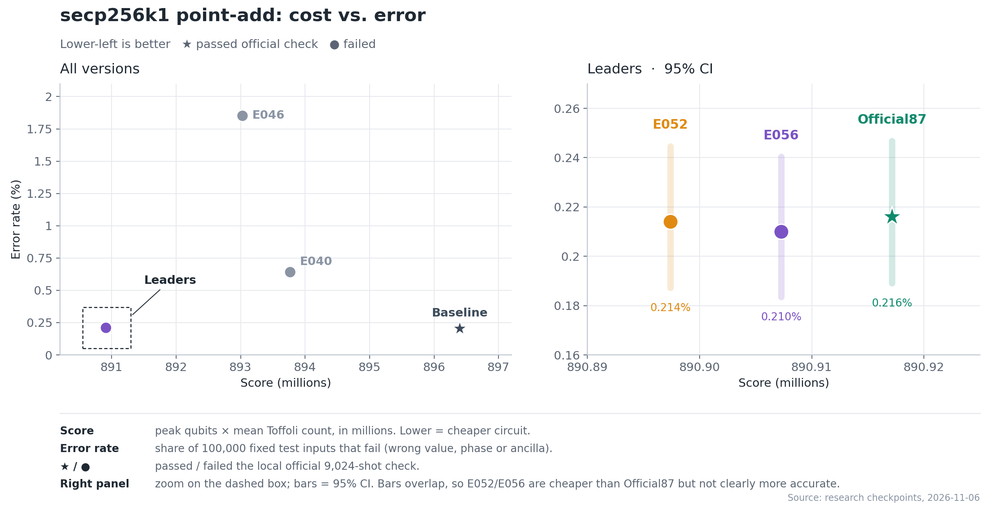

# ECDSA Research

> **Branch `leaderboard-E056`.** Experiment and code by Chen Yuguo, building on the public ECDSA.Fail leaderboard circuit (Layr-Labs/ecdsafail-challenge, commit 87f0aaf3). The folder official_87f0aaf3/ is the unmodified upstream circuit; the other circuit folders are derived variants used in the experiment.

Research on reversible **secp256k1 point-addition circuits**, resource-cost optimization, and GPU-assisted validation for the ECDSA Fail challenge. This repository collects circuit implementations, optimization experiments, GPU validation tools, and research findings on the trade-off between quantum resource cost and circuit correctness.

The resource objective is **peak qubits × rounded mean executed Toffoli count** (lower is better). Resource cost and correctness are tracked separately: a lower score alone does not establish a valid circuit.

## Research focus

The project investigates three connected questions:

- **Circuit cost:** how arithmetic schedules, pair-aware records, and selective fold-window changes affect executed Toffoli counts and peak qubit usage.
- **Correctness beyond the benchmark:** how candidates behave on common development inputs and separate held-out inputs, including value, phase, and ancilla failures.
- **Validation throughput:** how architecture-matched CUDA replay and progressive screening can reduce the cost of evaluating candidate circuits and nonces.

Rust implements the circuits and packing utilities; CUDA accelerates replay and screening; Python supports experiment orchestration and result analysis.

## Latest research findings

**Latest recorded checkpoint: November 6, 2026.** The findings below summarize the preserved experiment records; they are not new benchmark runs.

### Circuit optimization

**Official87 remains the best locally official-valid reference in this research.** Its score is **890,917,150**, using **1,234 peak qubits**, and it passes all 9,024 local official evaluation shots. On the separate development corpus it has 216 union failures per 100,000 inputs.

**E052 is the lowest-score research candidate**, at **890,897,406**: 19,744 below Official87 (approximately 0.00222%). It narrows the forward fold window at R125 pair-site 80 from 57 to 56 bits. Development union failures are 214/100,000, with the same value-failure mask as Official87. It fails the local official evaluation (13 classical and 6 phase failures), so it is not a validated replacement.

**E056 is the latest error-efficient structural candidate**, at **890,907,278**. It selectively widens raw tick 81 within E052's pair-site-80 change to 58 bits. It repairs the census-predicted development value failure and records 210/100,000 development union failures. On a separate held-out 100K corpus it records 213 failures versus Official87's 214. These differences do not establish a statistically significant overall error reduction. E056 also fails the local official evaluation (13 classical and 5 phase failures).

The structural experiments show that savings do not necessarily add: combining eleven individually promising fold sites in E053 increased the postprocessed Toffoli cost relative to E052. Raw-tick identity and forward/reverse direction matter when choosing repairs.

### GPU validation and screening

On an RTX 4090, architecture-matched replay agrees with the CPU reference on the checked 10K inputs, including value, phase, ancilla, and per-batch Toffoli measurements. A progressive **512 → 1,024 → 2,048 → 9,024-shot** schedule evaluated a fixed set of 256 E048 nonces in **98.719 seconds**, compared with **543.326 seconds** for exhaustive replay: a measured **5.504× speedup**, with zero prefix-mask disagreements. All 256 nonces were dirty; the known-clean Official87 control passed every stage.

The later approximate R125 fold filter reached **1,898 nonces/s** in an 8,192-nonce test. Combining approximate ranking with exact progressive replay processed the fixed 256-nonce corpus in **54.904 seconds** (4.663 original nonces/s). Approximate filters are ranking heuristics, not correctness verdicts; their rejected candidates remain deferred because clean-candidate recall has not been established.

### Latest search status

The completed E048 pilot evaluated **292 nonces** with full 9,024-shot replay and found **no clean nonce**. A later bounded search was stopped after approximate screening of 4,096 nonces; 648 candidates were packed for exact replay, but that replay was interrupted. The interrupted range has **no recorded exact verdict** and does not establish a successful candidate.

Detailed evidence:

- [Official87 reproduction and E048–E050 experiments](r125_opt/src/point_add/memory/official87-2026-11-06.md)
- [R125 census, E051–E056, and GPU screening measurements](r125_opt/src/point_add/memory/r125-pair-aware-2026-11-06.md)
- [Latest stopped search checkpoint](scratch/official87-validation/clean-search-e048-20261106/STOPPED_CHECKPOINT.md)

## Directory structure

```text
ecdsa-research/
├── README.md                 Repository overview and navigation
├── .gitignore                Excludes build outputs and generated datasets
├── plot/                     Current figures, result CSV, and plotting scripts
├── artifacts/                Earlier figures and plotting scripts
├── baseline/                 Main experimental working snapshot and research history
├── official_87f0aaf3/         Official87 reference snapshot
├── official87_opt/           Optimization experiments based on Official87
├── pareto_e040/              E040 cost/error trade-off snapshot
├── e048_rebuild/             E048 reconstruction and validation snapshot
├── r125_opt/                 R125 optimization snapshot used by the GPU packer
├── gpu_skywalk/              Rust input/operation packer, CUDA replay, Python analysis
├── gpu_toolkit/              GPU nonce-search toolkit with its own documentation
├── scratch/                  Exploratory scripts, notes, and local validation outputs
├── scripts/
│   └── export_github.py       Creates a clean, standalone source export
└── error-efficient-tests.list  Recorded targeted test selection
```

Each circuit snapshot is a separate Cargo project, not a member of a root Cargo workspace. Its main files are:

| Path within a snapshot | Purpose |
| --- | --- |
| `src/point_add/` | Circuit implementation and arithmetic primitives |
| `src/point_add/memory/` | Research notes, experiment decisions, and historical evidence |
| `src/circuit.rs`, `src/sim.rs` | Circuit representation and simulation infrastructure |
| `src/bin/` | Circuit-building, evaluation, and research utilities |
| `Cargo.toml`, `Cargo.lock`, `rust-toolchain` | Dependencies and pinned Rust toolchain |
| `results.tsv` | Historical benchmark records |
| `README.md`, `NOTICE` | Upstream challenge documentation and attribution |

Directory names identify research branches/snapshots, not a guarantee that their current files match a particular historical result. In particular, `baseline/` contains subsequent experiments as well as the original baseline history. Commit labels identify historical experiments; their measurements should be read alongside the corresponding research notes.

## Where to start

- **Results:** [summary CSV](plot/research_results.csv) and the figure below.
- **Challenge and circuit interface:** [reference README](official_87f0aaf3/README.md).
- **Experiment reasoning:** [baseline research notes](baseline/src/point_add/memory/).
- **GPU nonce search:** [GPU toolkit README](gpu_toolkit/README.md).
- **Independent replay and failure analysis:** [GPU replay guide](gpu_skywalk/README.md).

## Recorded results

These are historical measurements from `plot/research_results.csv`, not fresh benchmark runs.

| Version | Historical commit | Score | Union failures / 100,000 | Local official evaluation passed |
| --- | --- | ---: | ---: | :---: |
| Baseline | `667ce8d4` | 896,396,908 | 204 | Yes |
| E040 | `57a62d9e` | 893,766,672 | 641 | No |
| E046 | `49eb0909` | 893,028,824 | 1,854 | No |
| Official87 | `87f0aaf3` | 890,917,150 | 216 | Yes |
| E052 | `6ac627e5` | 890,897,406 | 214 | No |
| E056 | `e50c8152` | 890,907,278 | 210 | No |

Union failures count value, phase, or ancilla failures on the same fixed 100K development corpus. Passing the local official 9,024-shot evaluation does not imply zero error on other inputs. The small error-rate differences between Official87, E052, and E056 are not statistically resolved. E052/E056 are research candidates, not validated replacements for Official87.



## Running the code

### Rust circuit snapshots

Install Rust through rustup; the circuit projects pin Rust `1.93.0`. Run commands inside the selected snapshot, for example:

```bash
cd official_87f0aaf3
cargo build --release --locked --bin build_circuit --bin eval_circuit
```

Follow that snapshot's README and utility usage for evaluation. Building the executables does not itself validate a circuit. The snapshots include historical experimental changes and should be evaluated independently before drawing correctness conclusions.

### GPU tools

The GPU tools require an NVIDIA GPU and a compatible CUDA toolkit (`nvcc`), plus Python 3 for orchestration. The packer depends on the sibling `r125_opt` crate through a relative path:

```bash
cd gpu_skywalk
cargo +1.93.0 build --release --locked --bin skywalk_gpu_pack
```

See [gpu_skywalk/README.md](gpu_skywalk/README.md) for replay details and [gpu_toolkit/README.md](gpu_toolkit/README.md) for toolkit setup. Generated operation streams, input corpora, state dumps, and CUDA executables are excluded from this repository. Historical scripts can require these artifacts and specific circuit configurations; this is a research archive, not a one-command reproduction of every experiment.

### Regenerate the figures

From the repository root, with Python 3 and Matplotlib installed:

```bash
python -m pip install matplotlib
python plot/plot_results.py
python plot/plot_bar.py
```

The scripts in `plot/` read `plot/research_results.csv` and write figures alongside it; they do not run circuit benchmarks. `plot_bar.py` defaults to Baseline versus Official87 and accepts two version names, `--out`, `--title`, and `--labels` for other comparisons.

| File in `plot/` | Contents |
| --- | --- |
| `research_results.png` | Current overview of circuit cost and error, with a zoom on the leading candidates |
| `research_bar.png` | Saved bar-chart comparison |
| `research_bar_e056.png` | Saved E056 comparison |
| `research_results.csv` | Recorded measurements used by the plotting scripts |
| `plot_results.py`, `plot_bar.py` | Figure generation scripts |
| `research_results_old.png` | Previous overview retained for reference |

Earlier PNG/SVG figures and their original scripts remain in `artifacts/`.

## Attribution and licensing

The circuit snapshots retain their upstream `NOTICE` files, including attribution for reused circuit/simulator code under CC BY 4.0; see [the reference NOTICE](official_87f0aaf3/NOTICE). The GPU toolkit carries its own [MIT license](gpu_toolkit/LICENSE). This collection does not add a blanket license or replace those component-specific notices.
